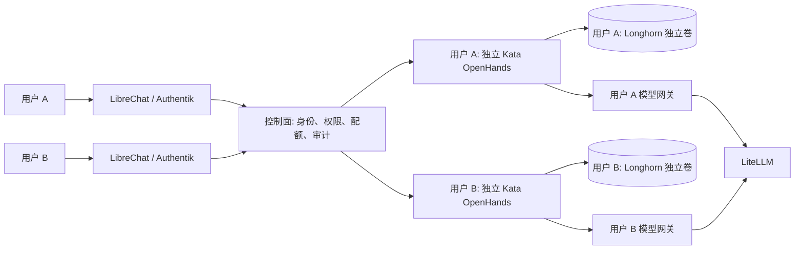

# 每用户独立 OpenHands 和磁盘设计

## 目标与当前状态

每个经过验证的 Authentik 用户拥有独立的 OpenHands 运行实例和 Longhorn 持久卷，不与其他用户共用进程、工作目录或凭据。多个项目可以位于同一用户的磁盘中，项目文件、Agent 状态、测试文件和构建工作目录都计入该用户的存储额度。用户用完可以暂停计算并保留磁盘；需要彻底删除时，按明确确认和保留策略回收资源。

这是目标设计，**当前尚未开通自动创建、访问、暂停或删除**。现有 `openhands/openhands-agent-canvas` 是单用户验证实例，不能用它承载多个用户。控制面已有资源计划只生成规划，不会创建实际工作环境。

## 隔离单位

以 Authentik access token 验证后的 `(issuer, subject)` 为用户身份；不能使用浏览器传入的用户 ID、邮箱、项目名或 Kubernetes 名称决定资源归属。每用户一组专用 namespace、Agent Canvas Pod 和 PVC；唯一约束及所有者记录由服务端管理。集群管理员仍拥有集群级访问能力，Kubernetes 和平台访问审计需要覆盖这种管理操作。

每人一卷是逻辑磁盘隔离，Longhorn 仍共享节点物理磁盘，不等于每人独享一块物理硬盘或独享独立故障域。当前单节点也不具备节点高可用。PVC 以容量限制文件系统；实际物理占用还受副本、快照、备份、容器临时层和日志影响，必须同时监控 Longhorn 和节点剩余容量。工作卷、Agent 本地状态和临时项目资料共计入该卷配额；Pod 临时层、日志和未来外部数据库、对象存储另行设置限制和统计，不能仅凭 PVC 配额宣称覆盖所有空间。

初版采用已有工作空间默认值：每用户 5 GiB（可由管理员调整），明确这是初始值而非承诺的永久套餐；节点容量不足时拒绝或排队，不能超配后假称可用。分配是按需发生，普通注册不会立刻启动一台实例。部署前须核对 Longhorn 实际可用容量、默认副本数和安全余量。

## 用户、项目与访问

1. 用户在 LibreChat 创建一个开发项目；平台验证其用户和项目归属，并确定该用户的专属环境。首次使用时申请环境；再次使用时恢复原环境，不为每条对话启动新实例。
2. 用户卷中保存 OpenHands 自身状态，以及受平台控制的 `projects/<opaque-project-id>` 项目目录。客户端不能提交绝对路径、`..`、符号链接或任意挂载点来绕过目录校验。每次进入、运行任务或读取文件都核验用户与项目权限。
3. 单用户环境中的 OpenHands 与用户代码不提供不同项目之间的强安全边界：同一用户的 Agent 可能访问该用户卷中的其他项目。多人协作、用户互相分享项目或需要强项目隔离时，应单独设计项目级环境和授权；不能把它视为已经隔离。
4. 控制面通过受身份验证和授权的内部代理调用指定用户实例，浏览器不能直接凭用户提供的地址访问 Agent。所有访问记录关联用户、项目、任务和请求 ID，不记录源码、密钥或提示词。
5. OpenHands 的模型调用必须关联该用户的 LiteLLM 用户和预算，管理密钥绝不进入 Pod。需要单独设计代理凭据与任务作用域：用户代码与 Agent 在相同运行环境时，放在 Agent 进程或文件里的凭据可能被用户代码读取，因此不能仅靠环境变量声称凭据与用户代码隔离。

## 资源、安全和运行状态

每个实例使用当前已安装的 `kata-qemu-runtime-rs`、非 root、无特权、无宿主机 Docker socket、无默认 ServiceAccount token；设置 CPU、内存、临时存储、进程和请求超时限制。网络默认拒绝，按实际需要仅允许 DNS、受控的模型代理和工作所需出口；不得默认连接 Kubernetes API、其他用户空间或管理服务。Agent 和项目访问密钥、模型凭据、代理认证以及日志脱敏须分开设计和验证。

控制面采用可重试对账：`requested → provisioning → ready`，以 PVC Bound、Pod Ready、OpenHands 健康与代理鉴权共同判定 ready；失败记录具体阶段而不是返回成功。资源都有不可由客户端指定的所有者标记，重复请求使用幂等键；并发创建同一用户时唯一约束只允许一个生效。集群 API 权限只授予独立工作器必要操作，浏览器和 Agent 不持有管理凭据。

## 暂停、恢复与销毁

- **暂停**：停止任务并确认 Pod 已退出，保留 PVC 和项目文件，释放已确认停止的计算配额；保留卷仍计入存储额度。空闲自动暂停前需处理进行中的任务并记录状态。
- **恢复**：核验身份和配额，重新挂载同一 PVC 并启动同一用户实例，等待健康检查；不得生成新的空卷冒充恢复成功。
- **删除项目**：只删除该用户被授权的目标项目；必须防止路径穿越、符号链接跨目录和并发任务写入。项目删除不应删除同一卷上的其他项目或用户环境。
- **删除用户环境**：先停止任务、撤销代理权限和专属凭据，再移除实例，按用户明确选择和保留期决定是否删除 PVC；显示不可恢复范围并记录审计。Longhorn 卷、快照及备份须分别核验，备份可能按保留期继续存在。当前 `longhorn` StorageClass 的回收策略为 Delete；误删 PVC 可能导致数据销毁，不能把它当作暂停。
- 每一步需要归属校验、幂等重试和失败状态；只在确实确认外部资源释放后归还相应配额。孤儿资源先告警，再按明确归属和保留规则处理。

## 验收门槛

在真实集群中使用两个临时用户验证：独立 Pod、卷和凭据；写入彼此不同文件；尝试跨用户读取卷、文件、Agent API 和日志均失败；测试硬盘写满、临时存储限制和节点容量不足；暂停后卷与资料保留、恢复仍为原文件；只删除 A 的项目与环境后 B 完整可用；测试网络中断、工作器重启和重复删除，实际回收后才释放额度。核验备份恢复及 Longhorn 快照/备份保留后，再接入普通用户入口。
